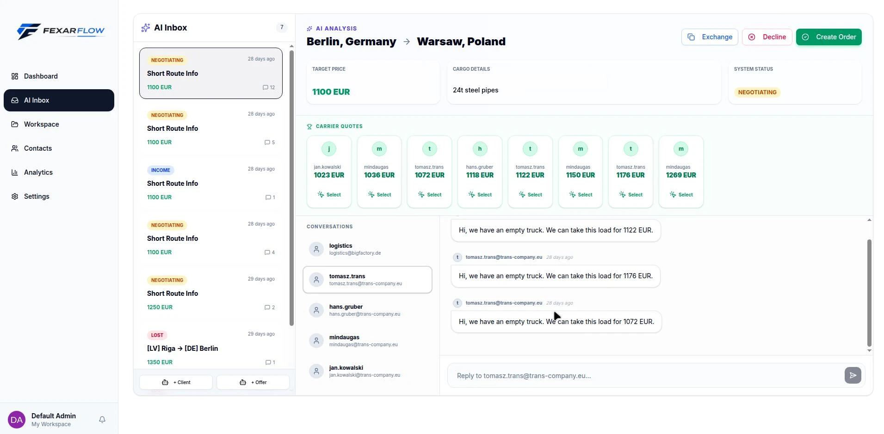
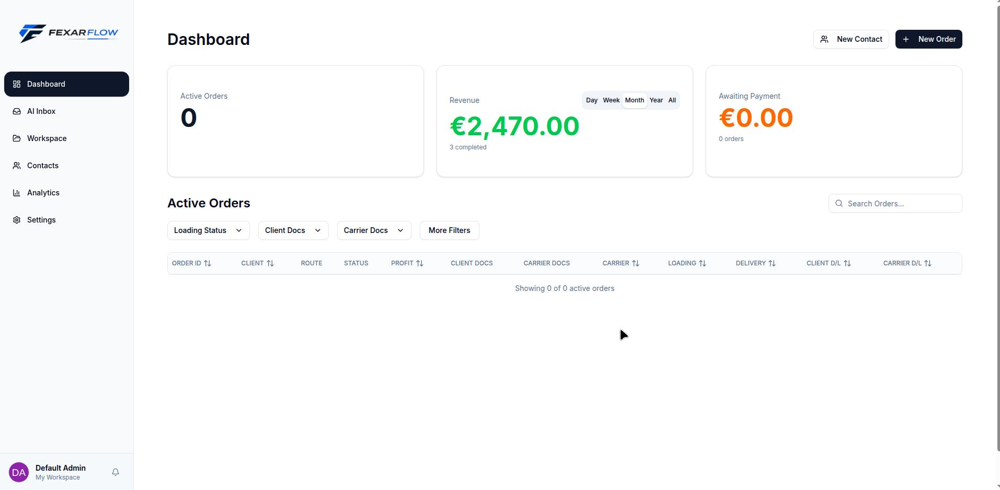
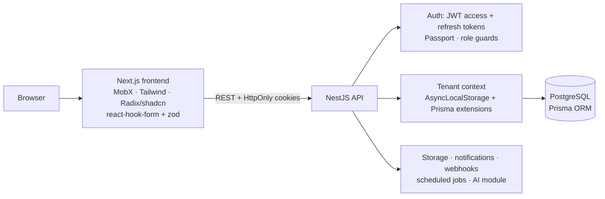

# FexarFlow — multi-tenant CRM / TMS for freight forwarders

A B2B SaaS that runs the daily operations of a freight forwarding company: clients and carriers, transport orders, documents, payment deadlines and margin analytics — with several companies (tenants) on one platform.

Designed and built solo, Dec 2025 – Apr 2026.
**The source code is private** (commercial project). This page describes what the system does and how it is built; I'm happy to walk through the code and architecture on a call.

## Screenshots

**AI Inbox** — incoming client requests and carrier replies parsed by an LLM: route, cargo and target price are extracted, carrier quotes are collected side by side, and a deal can be turned into an order in one click.

**Dashboard** — active orders, revenue by period, payments awaited.

## What it does

- **AI Inbox** — LLM analysis of email threads with clients and carriers: extracts route, cargo and target price, collects carrier quotes, tracks negotiation status, creates an order from the chosen quote.
- **Orders** — transport orders with client and carrier sides, automatic profit and margin calculation, soft delete, order completion workflow.
- **Documents & payments** — transport order and invoice PDFs generated on the client, payment-deadline tracking.
- **Contacts** — clients and carriers, bank details validation, search, filters, pagination.
- **Deals** — sales pipeline before an order exists.
- **Dashboard** — KPIs and an active-orders table with sorting.
- **Analytics** — company-wide revenue, profit and margin by month, with role-based access to the data.
- **Companies (tenants)** — each company has its own workspace, requisites for documents and UI branding (primary color).
- **Users & roles** — Admin / Manager / Worker with different permissions; session management.
- **Notifications, webhooks, scheduled jobs**, Excel import of existing data, and an **AI module** (LLM via Groq).

## Architecture

- **Multi-tenancy:** the current company is kept in `AsyncLocalStorage` for the whole request; Prisma extensions add the tenant filter to every query, so one company can never read or change another company's data. Isolation is covered by E2E tests.
- **Auth:** short-lived JWT access tokens plus refresh tokens in HttpOnly cookies; role guards on every endpoint.
- **Validation:** DTOs with `class-validator` on the backend, `zod` schemas on the frontend.
- **API docs:** Swagger.
- **Security:** Helmet, bcrypt password hashing.

## Stack

| Layer | Tech |
|---|---|
| Frontend | Next.js 14, React 18, TypeScript, MobX, Tailwind CSS, Radix UI / shadcn, react-hook-form, zod |
| Backend | NestJS 11, TypeScript, Prisma 6, PostgreSQL (Supabase), Passport-JWT, class-validator, Swagger |
| Infra | Docker (dev and prod compose), GitHub Actions CI, Vercel (frontend) |
| Testing | Jest + Supertest E2E suite: auth, contacts, orders, dashboard, analytics, users, companies, full business workflow |

## E2E test coverage

Eight E2E suites run against a dedicated test database: authentication flow (login, refresh, logout), role-based access for every module, order business rules and margin calculation, KPI and analytics calculations (including year boundaries and empty data), cross-tenant isolation (an admin of company A cannot modify company B), and a full workflow from user creation to order completion.

## Contact

Sevastjan Pashetov — full-stack engineer, Riga (EU). GitHub: [@Fexar123](https://github.com/Fexar123)
